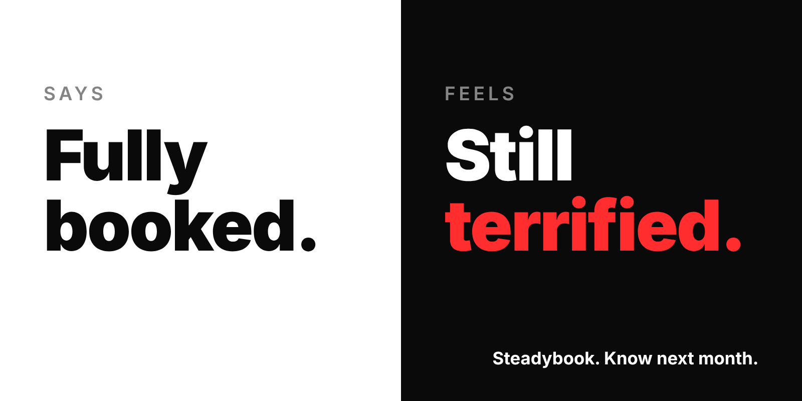
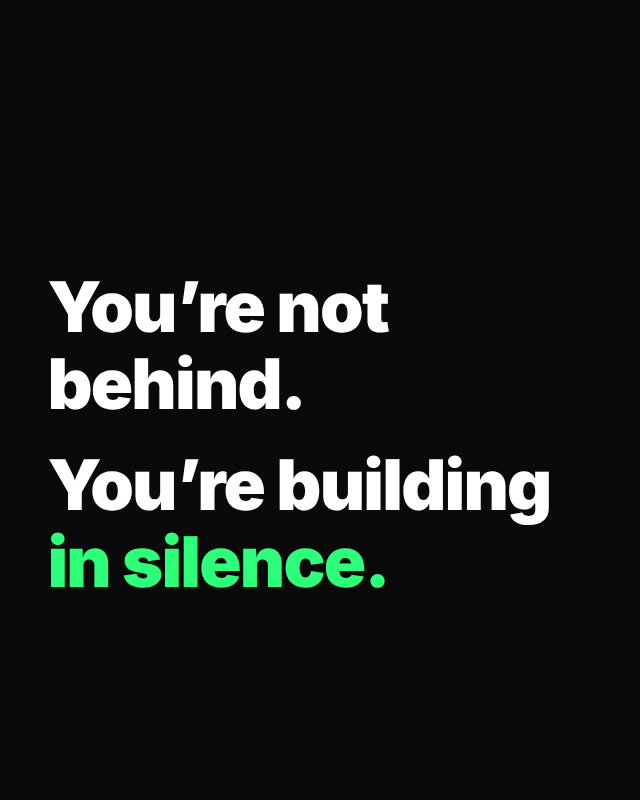

# Mastermind Ad Engine

**Static ads people actually feel — billboards, posters, print, and social statics.**

Most ads don't fail because they're ugly, too long, or missing a CTA. They fail because they don't make anyone *feel* anything. This plugin teaches Claude the Mastermind method: build every ad from one raw emotional truth outward, flip the category's lazy logic, compress it into a line that lands in three seconds, frame it in a visual that delivers the feeling, and score it honestly before it ships. Claude then renders the ad as an SVG mockup you can look at, test, and hand to a designer.





*Both examples were rendered from the templates the plugin uses. Steadybook is a fictional brand.*

## The method

```
Clarify → Flip → Write → Design → Tribe → Platform → Taste Test
```

1. **Clarify the emotional truth** — Shame Scanner, Contradiction Stack, and the Spike Meter find the *Spike Core*: the contradiction your audience lives with and hides.
2. **Flip the category logic** — the Default Belief Scanner and Reframe Reactor Grid turn a safe assumption into relief; a Rebel Archetype gives it a voice.
3. **Write a sticky punchline** — one emotional weapon (Shame Mirror, Contradiction Cut, Identity Unlock), the 3-Second Truth Test, and the Micro-Loop.
4. **Design the visual twist** — the Style Mapper matches emotion to format (Bold Poster, Screenshot Confession, Mirror Split, Receipt Stack, Meme Flip); the Chokehold Constraints force clarity.
5. **Identify the micro-tribe** — the Identity Grid ("I am… / But I feel… / And I wish…"), Shadow Matchmaker archetypes, and the Recognition Filter.
6. **Match the platform** — Instagram, TikTok, LinkedIn, email, and out-of-home rules for billboards, street and transit posters, and print.
7. **Taste test and iterate** — the 5D Taste Calibration Grid, the A/B War Room 2×2, and the Reality Loop.

## What's inside

| Component | Type | What it does |
|---|---|---|
| `ad-blueprint` | Skill | Runs the full 7-step build — guided or on autopilot — and delivers an Ad Build Sheet plus a rendered mockup. |
| `quick-ad` | Skill | The 15-minute Quickstart Builder: one truth, one punchline formula, one format, a three-question test. |
| `ad-critique` | Skill | Scores an existing ad or mockup like a cold-blooded creative director and gives concrete rewrites. |
| `ad-remix` | Skill | 2×2 variants, the pre-launch checklist, remix recipes for ads that flopped, and scaling one idea into 5–20 ads. |
| `cold-creative-director` | Agent | A fresh-context reviewer that judges the finished ad without seeing the reasoning behind it, so scores aren't self-graded. |

The `ad-blueprint` skill carries the full reference set: each step's tools, the Spike Vault of scored example lines by audience, 25 punchline templates, mockup sizes for common billboard, poster, and social formats, and a complete worked example.

## Install

**Claude Code**

```
/plugin marketplace add zerobline/claude-plugin-adcreation
/plugin install mastermind-ad-engine@zerobline-adcreation
```

**Claude apps (claude.ai and desktop):** once the plugin is listed in the plugin directory, add it from **Customize → Plugins**. Until then, download this repository as a ZIP and upload it there.

## Use it

Just describe the ad you need; the right skill loads on its own. In Claude Code you can also call the skills directly, for example `/mastermind-ad-engine:ad-blueprint`.

- "Make a billboard for our bookkeeping app for freelancers — 48-sheet, city centre."
- "Walk me through building an Instagram ad for my yoga studio, step by step."
- "I need a poster line for our café's new opening hours, quickly."
- "Here's our current LinkedIn ad [image]. Rate it and tell me what to fix."
- "Give me four variants of this ad to test."
- "This post got zero shares. Remix it."

## What it does and doesn't do

- **Runs nothing external.** No MCP servers, hooks, or scripts, and no network requests. The plugin is instructions and reference material only.
- **Writes files only when building mockups:** self-contained SVG (or HTML) files in your working folder, named `ad-<slug>-<placement>.svg`.
- **Mockups aren't print files.** Final artwork still needs to be produced to the media owner's or printer's spec (size, bleed, colour profile, resolution).
- **Mirror, don't wound.** The method exposes truths your audience recognises in themselves; it's built to end in relief, not humiliation. It also steers away from invented testimonials and statistics, imitating real people or brand interfaces, and copyrighted meme or stock imagery.

## License

[MIT](LICENSE) © zerobline
